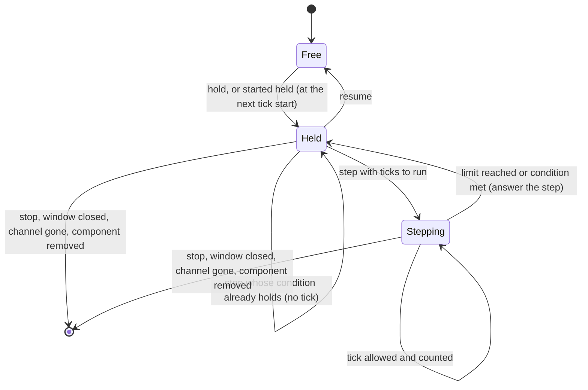

# Controlled Time

**Version:** 1.0.0
**Status:** Stable
**Layer:** concept

## Overview

How an agent holds a running game still and advances it by an exact number of simulation ticks, so that every answer describes the state after exactly the ticks it asked for. Holding is an opt-in state of a running game: reads and explicit changes are answered while it holds, operations that need time to pass are refused with the way to let time pass, and the hold always ends safely.

## Related Specifications

- [l1-runtime-observability.md](l1-runtime-observability.md) - The running-game concept this one extends; RO-1 to RO-10 still apply to a held game.
- [l1-tool-catalog.md](l1-tool-catalog.md) - Hold and held steps are offered through the catalog's running-game tools.
- [l2-held-stepping.md](l2-held-stepping.md) - Where this concept is realized.

## 1. Motivation

A game that keeps running while it is observed cannot be tested reproducibly: between a step and the next read, frames, timers and nodes that ignore a pause have moved on. Pausing the game is not holding it: a paused game still draws frames, runs what is set to run while paused, and lets its own code unpause it. An agent that plays a game needs to act, advance a known amount and look, with nothing passing in between, and to know whether the advance was exact.

## 2. Constraints & Assumptions

- The engine runs a fixed-rate simulation tick and a separate frame. Exact stepping needs the frame rate fixed to the tick rate; only a launch the server controls can fix it.
- Work on other threads, on the file system and on the GPU is not driven by ticks and takes real time.
- Holding happens inside the game's main loop, so a held game serves requests from inside that loop; the channel to the game must be serviceable from there.
- **Assumption (forecast):** agents reach the hold through the existing running-game tools, not a separate tool or a separate channel. Runner-up: a dedicated time tool. Override: `/magic.spec amend l1-controlled-time.md "a dedicated time tool"`.

## 3. Core Invariants

- **CT-1 Opt-in hold.** A game runs freely until it is asked to hold, by an explicit call or by being started held. Leaving the hold is an explicit call too. A game that is not held behaves exactly as before this concept existed.
- **CT-2 Held between requests.** While a game holds and no step runs, no tick, no frame, no timer and no awaited signal advances, including the parts of the game set to run while paused. Reads and explicit changes are still answered, and the game's window stays responsive. The game's own pause cannot release the hold.
- **CT-3 Exact ticks.** A held step of N ticks lets exactly N complete ticks run, then holds again. Its answer is the state after those ticks and reports how many ran.
- **CT-4 Bounded, code-free conditions.** A held step may stop early on a condition. The condition is checked before every tick, the first included (a condition that already holds runs no tick); the step stops at a maximum number of ticks and reports whether the condition was met. A condition compares a public value of the game, under the same rules as a wait; it never evaluates an expression or calls a method (RO-6).
- **CT-5 Exactness is declared, verified and reported.** Stepping is exact only when every tick is paired with one frame at a fixed rate. The hold reports whether it is exact and, when it is not, why. A step that observes frames not advancing with its ticks revokes the claim for the rest of the run.
- **CT-6 Ticks are not paced by the clock, steps are bounded in time.** A held step runs its ticks as fast as the game can, so its maximum bounds ticks, not seconds. The server still bounds how long it waits for a step (RO-9). A step that outlives that bound finishes in the game and holds again; the error says so and how to look at the state before stepping again.
- **CT-7 Tick-scheduled input.** Input sent to a held game enters through the same entry point as a device's input (RO-7 still releases it). A release scheduled for later falls due by tick count, so splitting one step into several does not change what the game sees. When a press first becomes visible to the game is measured on a real engine and pinned by a test.
- **CT-8 Time-driven operations are refused while held.** An operation that needs frames or real time to pass inside the game — a frame wait, watching signals for a while, a multi-frame capture, a timed gesture, typed text — is refused at once while the game holds, with the held step that replaces it. It is never left waiting on time that will not pass.
- **CT-9 The hold always ends safely.** Leaving the hold, stopping the run, the human closing the game's window or stopping it from the editor, the server's channel to the game going away, and the in-game component leaving the game each end the hold. Ending it releases every held and scheduled input. A held game never outlives the channel that drives it as a frozen window.
- **CT-10 Debugging coexists.** A breakpoint hit during a held step stops the game as usual. A debugger pause request on a held run the server debugs is refused, because the game is already still.

## 4. Detailed Design

### 4.1 The Hold Point



The hold point is the start of a tick, before any part of the game runs that tick. Being there means the previous tick and its frame are complete and the next has not begun.

### 4.2 Step Counting (pseudo-code)

```plaintext
begin(limit, condition):  active = true; ticks_run = 0; until_met = false
at_tick_start():
    release the scheduled inputs whose tick has come
    if not active: hold
    if condition given and condition(): until_met = true; active = false; hold
    if ticks_run >= limit: active = false; hold
    ticks_run += 1; total_ticks += 1; let the tick run
```

`total_ticks` is the clock that scheduled releases are measured against.

### 4.3 Exactness

```plaintext
deterministic = launched_with_fixed_rate and fixed_rate == tick_rate and not revoked
after each step: if frames_advanced != ticks_run: revoked = true; reason = "frames did not follow ticks"
reason when false: one of "not started held with a fixed frame rate", "fixed rate differs from tick rate", "frames did not follow ticks"
```

## 5. Drawbacks & Alternatives

- **Unpaced ticks** make a long conditional step right after a launch run out before threaded loading finishes. Pacing ticks to the clock would make steps slow and inexact; instead the agent repeats short conditional steps and lets real time pass between them (CT-6).
- **Pause-based stepping** stays available for a game that is not held; it is cheaper and needs no hold, but it is not exact (§1).
- **An expression as the condition**: rejected; RO-6 allows no code from the caller in the game.
- **A separate driving channel** (files or a second socket) beside the debugger channel: rejected; a second way into the game doubles the access surface RO-5 keeps to one loopback connection.
- **Ending a held game after a period with no requests**: not needed; the server owns a held run and CT-9 ends the hold when the channel goes away.

## Document History

| Version | Date | Author | Description |
| --- | --- | --- | --- |
| 1.0.0 | 2026-10-21 | Agent (magic.spec) | Created from the request to bring exact time control into the server under its own rules: opt-in hold, exact and conditional steps without an evaluator, declared exactness, tick-scheduled input, refusal of time-driven operations while held, safe ending. Promoted to Stable after Post-Update Review. |
