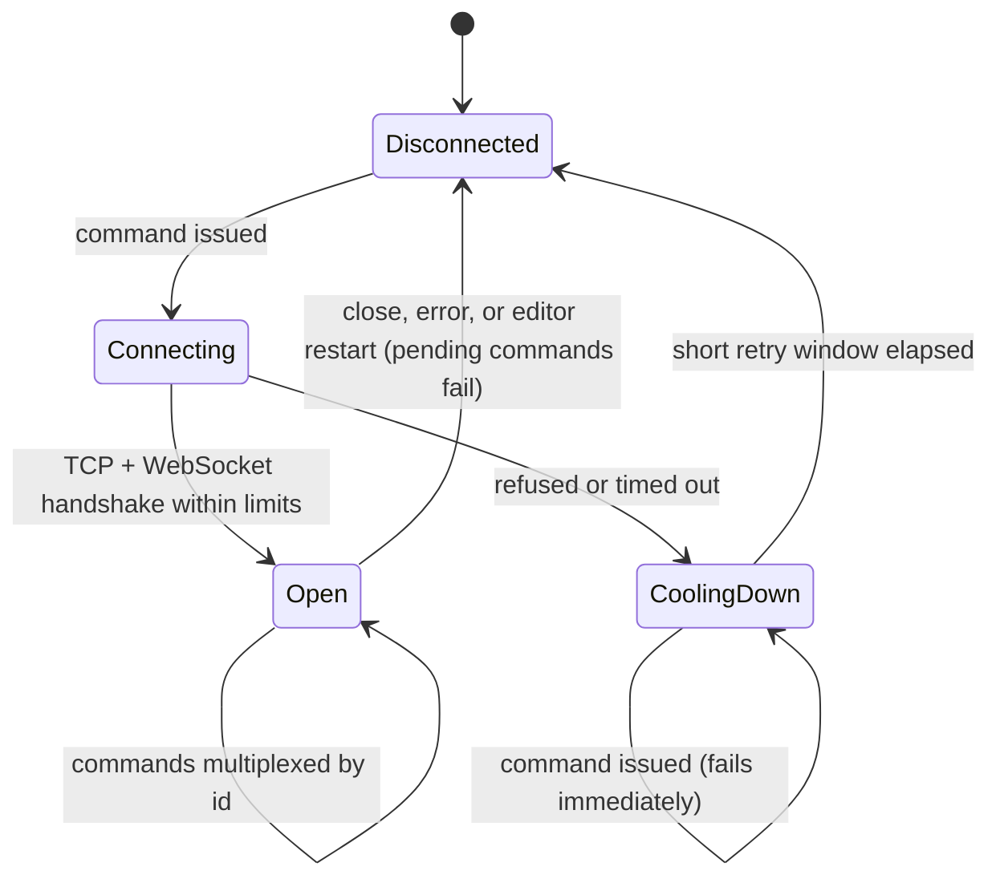
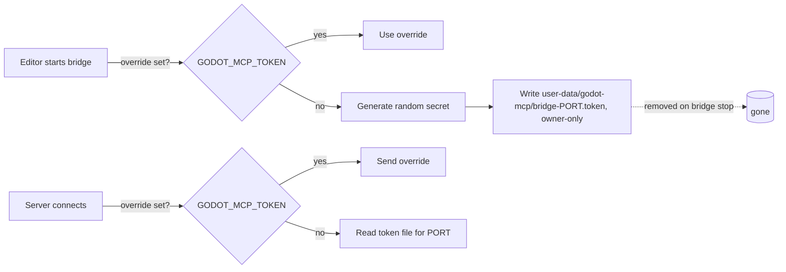

# Live Editor Bridge

**Version:** 1.0.0
**Status:** Stable
**Layer:** concept

## Overview

Defines the channel between the MCP server and a running Godot editor: who may connect, how commands and replies are framed and matched, what an editor-side mutation must guarantee to the human working in the same editor, and how the server tells "no editor" apart from "the editor said no".

## Related Specifications

- [l1-mcp-server.md](l1-mcp-server.md) - The client-facing session that issues bridge commands.
- [l1-tool-catalog.md](l1-tool-catalog.md) - Which tools need the bridge and how they fall back without it.
- [l2-bridge-client-rust.md](l2-bridge-client-rust.md) - Server-side implementation.
- [l2-godot-editor-addon.md](l2-godot-editor-addon.md) - Editor-side implementation.

## 1. Motivation

The editor is a live, stateful environment shared with a human. Anything an AI agent does there must be visible and reversible with the editor's own undo, must stay inside the scene being edited, and must not be reachable by other machines or by web pages open in the developer's browser. The 2026-10-14 simulation QA found the first bridge reachable from the LAN and from cross-origin browser pages, able to escape the edited scene, and able to silently drop property updates; this specification records the guarantees that closed those holes.

## 2. Constraints & Assumptions

- Transport: WebSocket over TCP on a single configurable port (default `9333`).
- Minimum editor version: Godot 4.5. Older editors refuse to start the bridge.
- The server and the editor normally run as the same OS user and share the user data directory. Containers, sandboxed packages and multi-user setups use an explicit shared secret instead.
- The editor processes commands on its main thread; a long command (re-import, viewport capture) delays the next one.
- Port selection on the editor side, first match wins: project setting `godot_mcp/bridge_port`, the editor's `GODOT_DEBUG_PORT` environment variable, `9333`.

## 3. Core Invariants

- **BR-1 Loopback only.** The editor side listens on the loopback interface exclusively; no configuration exposes it to other hosts.
- **BR-2 Shared secret on every command.** Each command carries a secret that the editor generates per session and port and publishes in a per-user location readable only by its owner. An explicit override value, set identically for both processes, replaces the published secret. A missing or wrong secret yields an explicit "unauthorized" error naming the recovery steps; no code path skips the check.
- **BR-3 Exactly one reply per command.** Every command — including malformed JSON, wrongly typed parameters, unknown command types, and replies too large to send — receives one reply, success or error. Parameters are validated before a handler runs so a type mismatch can never abort the handler without a reply.
- **BR-4 Correlated, multiplexed commands.** Each command carries a unique id; replies are matched by id, so many commands can be in flight on one connection and a late reply can never be delivered to the wrong caller.
- **BR-5 Undoable mutations.** Every editor mutation (add, remove, set properties) is recorded as a single action in the editor's undo history, and undo restores the previous state exactly — including node order and ownership of the removed subtree.
- **BR-6 Scene confinement.** Node paths are relative to the edited scene root and resolve only to nodes inside that scene; a path that leaves it is "not found". The scene root cannot be removed.
- **BR-7 All-or-nothing property updates.** A property update either applies every requested value or none. Values are converted to the target property's type; unknown properties and unconvertible values reject the whole call. The reply reports the values read back after applying.
- **BR-8 Fast, classified failures.** An unreachable editor is detected in well under a second and reported as "bridge unavailable"; a broken or stalled connection is reported as a connection error; an editor that answered with an error is reported with its own message. These three classes are never conflated. After an editor restart the next command reconnects without operator action.
- **BR-9 Version gate.** On an editor older than the minimum supported version the bridge does not start and says why.
- **BR-10 Editor-only.** The bridge and everything shipped with it are excluded from exported games, in debug and release builds.
- **BR-11 Project-confined paths.** File paths accepted by editor-side commands resolve to `res://` paths inside the project; absolute paths inside the project are converted, anything else (including parent segments) is rejected.

## 5. Detailed Design

### 5.1 Envelope

| Direction | Fields |
| --- | --- |
| Server → editor | `commandId` (unique string), `type` (command name), `params` (object), `token` (shared secret) |
| Editor → server | `commandId` (echoed), `status` (`success` or `error`), `result` (object, on success), `error` (text, on error) |

### 5.2 Command Set

| Command | Mutates | Notes |
| --- | --- | --- |
| `ping` | no | Liveness check |
| `get_version` | no | Engine version components |
| `get_project_info` | no | Name, main scene, features, absolute project directory |
| `get_open_scenes` | no | Open scene tabs and the active one |
| `get_scene_tree` | no | Active scene, or another open tab by `scene_path` |
| `get_node_properties` | no | Editor-visible properties as type + Godot text value (long values truncated) |
| `open_scene` | editor state | Opens a scene tab |
| `save_scene` | disk | Saves the active scene through the editor |
| `add_node` | scene (undoable) | Native classes and global script classes deriving from Node |
| `remove_node` | scene (undoable) | Restores order and ownership on undo |
| `set_node_properties` | scene (undoable) | All-or-nothing, typed conversion, read-back |
| `capture_viewport` | editor state | Switches the main screen to 2D/3D, forces a draw, returns PNG; refuses headless editors and tiny viewports |
| `run_project` / `stop_project` / `get_run_status` | play state | Editor Play mode |
| `resave_resources` | editor file system | Importable assets re-imported synchronously, other files refreshed; no paths means a background full rescan |

### 5.3 Connection Lifecycle

### 5.4 Secret Distribution

## 7. Drawbacks & Alternatives

- **Origin header checks** instead of a secret: browsers set `Origin`, but other local processes can forge it; a secret covers both.
- **One connection per command**: simpler, but cost a connect per call and flooded the editor's Output panel; replaced by one persistent multiplexed connection.
- **Chunked messages for large replies**: unnecessary once the editor's WebSocket buffers were raised; a reply that still cannot be sent is converted into a short error reply.

## Canonical References

| Alias | Path | Purpose |
| --- | --- | --- |
| `[CLIENT]` | `src/bridge.rs` | Server-side connection, multiplexing, secret lookup |
| `[EDITOR]` | `addons/godot_mcp/bridge_server.gd` | Editor-side listener, secret check, command handlers |
| `[GATE]` | `addons/godot_mcp/plugin.gd` | Version gate and bridge start-up |
| `[EXPORT]` | `addons/godot_mcp/export_plugin.gd` | Exclusion from game exports |

## Document History

| Version | Date | Author | Description |
| --- | --- | --- | --- |
| 1.0.0 | 2026-10-16 | Agent (magic.analyze first-time) | Reverse-engineered from the code at 94e4540; rationale from the 2026-10-14 simulation QA report (LAN/browser exposure, buffer limits, scene escape, silent property no-ops, undo fidelity, 4.5 API guard). |
