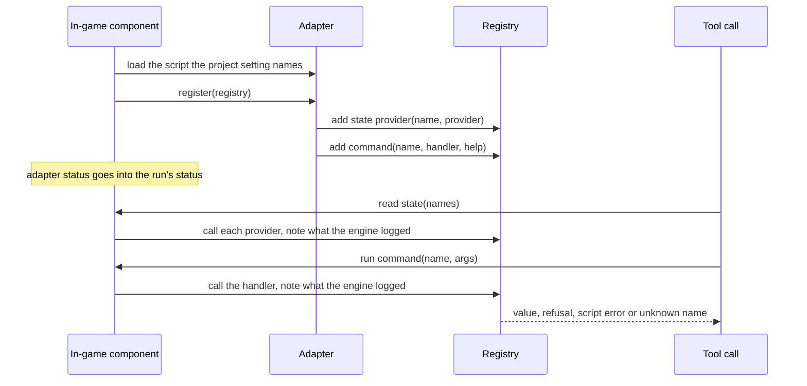

# Project Adapter

**Version:** 1.1.0
**Status:** Stable
**Layer:** concept

## Overview

A project can teach the running-game tools its own vocabulary: named state the game can be read for ("the run", "the level") and named commands it can be asked to run ("start a run on stage 15", "clear the level"). The project registers them in one development-only adapter script that it owns; the tools read and run only what that adapter registered, and the caller still sends no code into the game.

## Related Specifications

- [l1-runtime-observability.md](l1-runtime-observability.md) - The running-game concept this one extends; RO-1 and RO-6 name the place of project commands.
- [l1-controlled-time.md](l1-controlled-time.md) - CT-2 and CT-8 decide what a held game answers; PA-9 applies them.
- [l1-tool-catalog.md](l1-tool-catalog.md) - The two tools join the catalog under its invariants.
- [l2-project-adapter.md](l2-project-adapter.md) - Where this concept is realized.

## 1. Motivation

The running-game tools see a game as a node tree with properties. An agent that tests a game thinks in the game's terms: is a run in progress, which level is active, how many bricks of each kind still stand. Reading that from the tree ties the agent to the scene's structure and costs many calls; acting on it is often impossible, because the actions a game offers (start a run, clear a level, grant an effect) free nodes or change the scene, which RO-6 refuses to a method call by design.

godot-dev-bridge, a separate command-line tool by the same maintainer, proved a shape that solves this: the project names one adapter script, the adapter's `register(registry)` adds state providers and commands, and the driver reads and runs them by name. The game treaker drives its play-tests through eleven states and four commands of such an adapter. Offering the same contract here gives an agent domain-level reads and actions without an evaluator, and lets an adapter written for godot-dev-bridge move to godot-mcp unchanged.

## 2. Constraints & Assumptions

- The adapter is the project's code, written by the project's developers, not by the caller. The caller can only name what the adapter registered.
- The scripting language has no exception handling: a failure inside the adapter's code cannot be caught, only observed through what the engine logs.
- By the project's convention the adapter is development-only: game code never names it; only one project setting does.
- [DR] The registration contract is godot-dev-bridge's (protocol 1): one `register(registry)` entry point, state providers, commands with a help line, and a refusal helper. An adapter that uses only those registration calls works unchanged; only the setting that names it differs, and engine types in its values (vectors, colours, objects) come back in the form property reads of the running game use, which may differ from godot-dev-bridge's. Rejected: a contract of our own (every existing adapter would need a rewrite); reading godot-dev-bridge's setting as well (the server would name another product's configuration for good, to save a one-line migration). Override: `/magic.spec amend l1-project-adapter.md "read the dev-bridge setting"`.
- [DR] This addon does not leave the adapter out of exports. Without the in-game component nothing loads it, so it ships as an inert file, while skipping it would break a release whose game code preloads it. A project that wants it out uses the exclude filter of its export preset. Rejected: skipping it in every export, as godot-dev-bridge does. Override: `/magic.spec amend l1-project-adapter.md "skip the adapter in exports"`.
- **Assumption (forecast):** godot-mcp stays an MCP server. This concept brings over the adapter, not godot-dev-bridge's command-line driving, its file channel into the game or its sessions that outlive the driver; a project that needs scripted or CI driving outside an MCP client keeps godot-dev-bridge for that. Runner-up: a command-line client in godot-mcp over a second channel into the game. Override: `/magic.spec amend l1-project-adapter.md "a command-line client"`.

## 3. Core Invariants

- **PA-1 One entry point, named by the project.** Project knowledge enters only through one adapter script, named by one project setting, with one registration entry point that receives the registry. Nothing in the server or the addon names a project class, a project path or a project state. With no setting, the tools answer that the project has no adapter and how to name one. The running-game tools never name or change the adapter: naming one is a change to the project, made by a person or through the authoring tools under their own rules, and it takes effect the next time the in-game component starts.
- **PA-2 Two kinds of registration.** A state provider takes no arguments and returns a value. A command takes the call's arguments as one dictionary and returns a value, and may carry a one-line help. A registration with another shape or an empty name registers nothing and is reported; the other registrations still register.
- **PA-3 Only what was registered runs.** The caller names a registered state or command and passes data. It never names a method, a script or an expression, and an unknown name fails with the names that are registered. RO-6 stays in force for every other call into the game.
- **PA-4 The project decides what its commands do.** A registered command may change the game in any way the project wrote, including what RO-6 refuses to a method call (freeing a node, changing the scene) and writing files; the server adds no refusal beyond PA-3 and saves nothing itself. The command tool is declared as changing the game, with a new effect on every repeated call. A state provider reads only, on the project's word: the state tool is declared read-only on that word, which the server does not verify.
- **PA-5 Refusal is explicit.** A command refuses its arguments only through the registry's refusal helper; the call then fails as bad arguments and carries the command's message. Every other returned value, a dictionary with an `error` entry included, is the command's result.
- **PA-6 Failures in the project's code are reported, not hidden.** Every answer of the two tools, and the run's status, say whether the adapter was named, loaded and registered, which registrations were refused, and why. A script error the engine logs while a provider or a command runs fails that provider's entry or that command with the error's text; other errors and warnings logged meanwhile come with the answer.
- **PA-7 Providers are isolated.** A provider that is missing, no longer valid or failing answers an error for itself only; the others still answer.
- **PA-8 One conversion, bounded answers.** Provider and command values are converted to JSON exactly as property reads of the running game convert them. An answer larger than the bound the implementation fixes is not returned: the call fails with the size of each requested state and asks for fewer names. Nothing is cut silently.
- **PA-9 Held games and deferred effects.** A held game reads state and runs commands — they are reads and explicit changes (CT-2) and need no time to pass, so CT-8 does not refuse them. The answer is what the provider or the handler returned at once; whatever the project's code defers (a deferred call, a timer, a signal) takes effect when the game next advances, so an agent steps before reading the result. A provider or handler that awaits is not supported: the engine logs a script error when it is called, and the call fails with that error (PA-6). [MODIFIED]
- **PA-10 Wherever the component runs, and only there.** The in-game component loads the adapter once when it starts, in a managed process run and in editor Play alike. A game started without the component (RO-4) never loads it.

## 4. Detailed Design

### 4.1 Registration and Use

### 4.2 Outcome Mapping

| Command outcome | Answer |
| --- | --- |
| the refusal helper's value | fails as bad arguments, with its message |
| a script error logged while the handler ran | fails as a failure reported by the game, with the error text and a note that the command may have changed the game before the error |
| any other value (empty included) | success, the value as `value`, other logged errors and warnings beside it |
| a handler that is no longer valid | fails as a failure reported by the game |
| an unknown name | fails as not found, with the registered command names |
| no adapter, or one that did not load | fails as unsupported, with the adapter status and how to name or fix the adapter |

## 7. Drawbacks & Alternatives

- **An expression evaluator** (godot-dev-bridge's `eval`): rejected; RO-6 allows no code from the caller in the game. The adapter is the way to project-specific actions.
- **A command-line client and a second channel into the game** (godot-dev-bridge's file spool): not part of this concept. A second way into the game was rejected for held stepping (l1-controlled-time §5) because RO-5 keeps access to one loopback connection, and a command-line client of an MCP server would need a resident process that holds the debugger connection. godot-dev-bridge serves command-line and CI driving. Revisit when a project needs that driving and godot-dev-bridge can no longer serve it.
- **Runs that outlive the driver**: unchanged. A managed run ends with the server (TL-6); editor Play already outlives it.
- **Scenario steps that run a command or read state**: deferred. They can be added to the scenario's schema later without changing these invariants; until then an agent alternates `godot_game_physics` steps with the two tools.
- **Reserved names**: godot-dev-bridge reserves its own command names because project commands share its verbs. Here project commands have their own tool, so no name is reserved, and an adapter that works there registers every command here as well.
- **Refusal by a reserved key**: the refusal helper's value is recognised by one reserved key, so a command that returned exactly that key by hand would read as a refusal. Accepted for compatibility; the helper is documented as the only way.

## Canonical References

| Alias | Path | Purpose |
| --- | --- | --- |
| `[REGISTRY]` | `addons/godot_mcp/runtime/ops/rt_registry.gd` | Registration, refusal and outcome rules (planned) |
| `[PROJECT-OPS]` | `addons/godot_mcp/runtime/ops/rt_project.gd` | Adapter loading, status, state reads and commands (planned) |
| `[GAME]` | `src/tools/game/` | The two tools |
| `[E2E]` | `tests/runtime_e2e_test.rs` | Real-game proof with a fixture adapter |

## Document History

| Version | Date | Author | Description |
| --- | --- | --- | --- |
| 1.0.0 | 2026-10-29 | Agent (magic.spec) | Created from the comparison with godot-dev-bridge: the one capability of that tool godot-mcp lacked is the project adapter, so its contract is brought over unchanged, with failures in the project's code reported through the engine's log instead of hidden. Its command-line client, file channel, evaluator and long-lived sessions are left out, with reasons. Promoted to Stable after Post-Update Review. |
| 1.1.0 | 2026-10-29 | Agent (magic.run) | [MODIFIED] PA-9: a provider or handler that awaits is not supported and fails through PA-6; the first version assumed it would hand back at its first `await`, which a real engine contradicts (measured by the feasibility test). Stable → RFC → Stable after Post-Update Review. |
