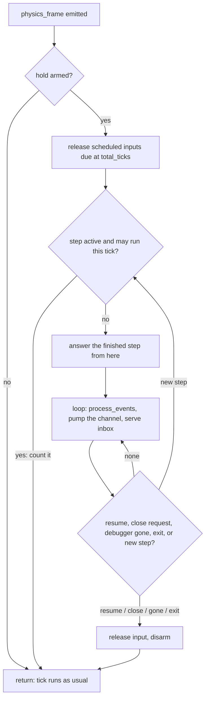

# Held Stepping

**Version:** 1.1.0
**Status:** Stable
**Layer:** implementation
**Implements:** l1-controlled-time.md

## Overview

How the server and the in-game runtime hold a running Godot game at the start of a physics tick, serve debugger-channel requests from inside that hold, run exact and conditional held steps, schedule input releases by tick, and report whether stepping is exact. Built on the existing game runtime channel; adds no channel, no evaluator and nothing that stays in the project.

## Related Specifications

- [l1-controlled-time.md](l1-controlled-time.md) - Parent concept.
- [l2-game-runtime.md](l2-game-runtime.md) - The channel, the runtime autoload, its jobs and the existing pause-based physics step this builds on.
- [l2-tool-handlers.md](l2-tool-handlers.md) - How the extended tool arguments are validated and routed.
- [l2-release-branches.md](l2-release-branches.md) - Carrying the change to every line and the API guards per line.

## 1. Motivation

The runtime already steps physics by pausing the tree, which leaves idle frames, `PROCESS_MODE_ALWAYS` nodes and timers running and is documented as not deterministic. A hold inside the main loop is the one place where nothing else in the game runs; it needs the debugger channel to be served from there and the frame rate fixed by the launch.

## 2. Constraints & Assumptions

- Requests reach the runtime as `mcp:request` debugger messages, dispatched by the engine's debugger poll, which normally runs once per main-loop iteration. A hold blocks that iteration, so the hold loop must drive the poll itself.
- Engine facts checked in the 4.5-stable sources: `EngineDebugger.line_poll()` is bound to scripts and fails without an active debugger; it runs a full non-idle poll (flush of queued outgoing messages, then dispatch of every received message to its capture, `mcp` included) on one call in 2048. The line's first release has it, so no `has_method()` guard is needed on any line.
- Verified on Godot 4.8-beta1 by the first end-to-end tests: the tree's `physics_frame` signal is emitted at the start of each physics iteration, before any node's `_physics_process`, also while the tree is paused; a window close request reaches the runtime node as `NOTIFICATION_WM_CLOSE_REQUEST` from `DisplayServer.process_events()` called inside the hold (Windows, `CloseMainWindow`).
- Measured: `EngineDebugger.is_active()` stays true after the debugger peer closes its socket (a plain TCP listener destroyed the connection and the game still reported active for the next five seconds), and the script API has no other check of the peer. The game cannot learn that the server is gone.
- Godot exposes no getter for the `--fixed-fps` it was started with, so the server declares it to the runtime with a user argument it writes itself.
- **Assumption (forecast):** a press injected at the hold point is first seen as just pressed on the second held tick, so a held tap releases after 2 ticks by default; this was measured on a prior implementation of the same hold point and is re-measured here before it is pinned. Runner-up: 1 tick. Override: `/magic.spec amend l2-held-stepping.md "tap releases after 1 tick"`.

## 4. Invariant Compliance

| L1 Invariant | Implementation |
| --- | --- |
| CT-1 Opt-in hold | `godot_game_physics` gains `action: "hold"`; `resume` leaves the hold; `godot_run_project` gains `held: true` (process runs only). Without either, no hook is armed and every tool behaves as in the game runtime specification. |
| CT-2 Held between requests | The hold loop runs inside the `physics_frame` handler, so the main loop stops before any node's physics callback, timer, tween, idle frame or draw. The loop calls `DisplayServer.process_events()` and pumps the debugger channel; nothing else runs. The game's `get_tree().paused` does not touch the handler, which is connected on the tree itself. |
| CT-3 Exact ticks | The step counter (§5.3) lets exactly `ticks` handler calls return; the answer is built at the next hold point with `ticks_run`, `total_ticks`, `physics_frames` and `process_frames`. |
| CT-4 Bounded, code-free conditions | `until` is the property-wait triple (`node`, `property`, `op`, `value`) parsed and compared by the same code as `godot_game_wait` (public names, `get` only, strict types); a condition that does not parse is refused before any tick; one that fails to read counts as not holding. `max` defaults to 600, at most 3600. |
| CT-5 Exactness declared | `deterministic` is true only on a run started with `held: true`, whose declared fixed rate equals `Engine.physics_ticks_per_second`, while no step has seen `process_frames` advance by other than `ticks_run`; otherwise false with `deterministic_reason` (§5.6). |
| CT-6 Unpaced, time-bounded | The server waits up to 60 s for a held step (longer than the 20 s of other runtime calls, still bounded). On timeout it answers an error saying the game finishes the step and holds again, and recommends `godot_game_physics` `status` before stepping again; the late reply is dropped by id. |
| CT-7 Tick-scheduled input | While held, `godot_game_input` applies its instant steps through `Input.parse_input_event` at once and records releases due at `total_ticks + hold_ticks`; the counter releases them at the start of the tick they fall due on, before the tick runs. `input.release_all` also clears the schedule. The measured visibility tick is pinned by the end-to-end test. |
| CT-8 Time-driven operations refused | While held, the runtime refuses at dispatch every request that would return a pending job (§5.5), with `R.BAD_PARAMS` and the held-step replacement in the message; it never creates the job. |
| CT-9 The hold ends safely | The loop leaves the hold on `resume`; on `NOTIFICATION_WM_CLOSE_REQUEST` received by the runtime node (the game then quits as it normally would); and from `_exit_tree`. `godot_stop_project` kills the process, held or not, and a server that exits normally kills the games it started (`GameHub` drop). Each exit releases held and scheduled input (RO-7). A server that is killed without that cleanup cannot be detected from the game (§2), so the game stays held; its window keeps answering, so closing it ends the hold. |
| CT-10 Debugging coexists | Breakpoints in game code fire during a held step's ticks as before. The server keeps the last hold state reported by the runtime on its `Run` and refuses `godot_debug_control` `pause` while it is held. For editor Play, a pause pressed in the editor's own debugger breaks inside the hold loop; continuing returns to the hold (documented limitation). |

## 5. Detailed Design

### 5.1 Files

```plaintext
src/
├── godot/runs.rs              held launch: --fixed-fps and the runtime's user arguments; hold state on Run
├── tools.rs                   godot_run_project held option, refused without mode "process"
└── tools/game.rs              godot_game_physics hold / held step arguments, 60 s held-step wait, debug pause refusal
addons/godot_mcp/runtime/
├── mcp_runtime.gd             hold flag consulted in _dispatch; close-request and exit handling
└── ops/
    ├── rt_hold.gd             hold loop, step counter, scheduled releases, exactness
    ├── rt_live.gd             game.physics actions routed to rt_hold while held
    ├── rt_input.gd            held mode of input steps
    └── rt_view.gd             held single capture of the last drawn frame
```

### 5.2 Tool Contract

| Call | Free game | Held game |
| --- | --- | --- |
| `godot_game_physics` `{"action": "hold"}` | Arms the hook; the game holds at the next tick start; the answer comes from the hold point. A pause left by the pause-based step is cleared first. | Answers the current hold status. |
| `{"action": "step", "ticks": N}` | Pause-based step, unchanged (1 to 120). | Exact held step, `ticks` 1 to 600. |
| `{"action": "step", "until": {...}, "max": M}` | Refused: `until` needs a held game; hint: `hold` first. | Conditional held step (CT-4). |
| `{"action": "resume"}` | Clears the pause, unchanged. | Leaves the hold; the game runs freely. |
| `{"action": "status"}` | Unchanged, plus `held: false`. | `held`, `deterministic`, `deterministic_reason`, `total_ticks`, `paused`, scheduled releases. |
| `godot_run_project` `{"held": true}` | Needs `mode: "process"`; otherwise refused with that hint (editor Play cannot fix the frame rate). Starts the game held from its first tick. | — |

Every held answer carries `held`, `deterministic`, `deterministic_reason`, `ticks_run`, `until_met` (conditional steps), `total_ticks`, `physics_frames`, `process_frames` and the scene context of the game runtime specification.

### 5.3 Hold Loop



The step decision is the counter of the parent concept (its §4.2). The loop waits a few milliseconds between rounds, like the debugger's own break loop, so a held game does not spin a core.

### 5.4 Serving Requests While Held

- **Pumping:** each round calls `EngineDebugger.line_poll()` until one full poll has run (at most 2048 calls; the count is kept in the runtime because the engine's counter is private). That dispatches received `mcp:request` messages to `_on_message`, which queues and dispatches them as today, and flushes the replies queued by the previous round. Messages of other captures (the editor's remote tree, profilers) are served the same way.
- **Hello before the first hold:** a game started held reaches its first hold point before the deferred `mcp:hello` has gone out; the first hold sends the hello itself if it has not been sent, so the server's wait for hello never meets a game that cannot answer.
- **Scene stamps:** `_note_scene()` runs before each answer, as `_process` would.

### 5.5 Operations While Held

| Served at once | Refused (with the held replacement) |
| --- | --- |
| `game.tree`, `game.get`, `game.signals`, `game.snapshot`, output reads | `input.wait` (frames, node, signal, property, scene generation) → held step, with `until` for a property |
| `game.set`, `game.call` (RO-6 unchanged) | `game.observe` → held step, then `godot_game_signals` / a read |
| `game.physics` held actions | `game.screenshot` with `frames` > 1 or `camera` → single capture between held steps |
| `game.screenshot`, one frame, no camera: the viewport's last drawn frame, no render wait; an error asks for one held tick when nothing was drawn yet | `input.run` steps `wait`, `text`, `swipe` → instant steps with held steps between them |
| `input.run` with only `key`, `mouse_button`, `touch`, `joy_button` (press, release, tap), `click`, `click_node`, `mouse_move`, `joy_axis`, `time_scale`; taps and clicks release after `hold_ticks` (default 2, 1 to 600) | — |
| `input.release_all` (also clears the schedule) | — |

### 5.6 Exactness

- A held launch adds `--fixed-fps R` to the engine arguments, where R is `physics/common/physics_ticks_per_second` read from the project (60 when unset), and after `--` the user arguments `--godot-mcp-fixed-fps=R` and `--godot-mcp-hold`. Both values are written by the server as integers; no caller string reaches the command line (TL-5).
- `deterministic_reason` is one of `not_started_held`, `fixed_rate_differs` (the game changed its tick rate, or the project file disagreed with the engine), `frames_did_not_follow_ticks` (revoked after a step), or empty when exact.

### 5.7 Release Lines

The change is a new capability, so it lands on `master` and is carried to every supported line, newest to oldest. Every engine call it uses exists in 4.5.0 (§2), so the carried copies need no guard; each line's end-to-end run proves it with that line's Godot build.

## 6. Implementation Notes

1. Feasibility test first, on a real game: hold, a held tick counter fixture, a request answered while held, a `Timer` and a `PROCESS_MODE_ALWAYS` node that do not advance while held, and the close request ending the hold. Its result confirmed the engine facts of §2 and measured the one that failed (a vanished server).
2. Runtime hold loop, counter, served/refused table, exactness; then the server's held launch, held-step wait and debug pause refusal.
3. Input schedule, then the pinned visibility measurement.
4. Tool descriptions, README rows and the security text updated with the behaviour (no reference to design files).

Tests: `runtime_e2e_test.rs` for every row above and for `deterministic` on a held launch versus a hold entered later; `editor_e2e_test.rs` for a hold on editor Play (served, `deterministic` false, `not_started_held`); `tools_test.rs` for `held` without `mode: "process"` and for argument bounds.

## 7. Drawbacks & Alternatives

- **A vanished server leaves the game held.** A keepalive the server sends every few seconds, with a silence limit in the runtime that releases the hold, would end it; the runtime would arm the limit only after the first keepalive, so the editor's Play (no keepalive) is unaffected. Not built: it adds a message, a limit and a failure mode (a suspended machine ends a hold that is only stalled), and no abandoned hold has been seen. Deferred through the forecast premise in the parent concept.
- **Editor Play is never exact:** its launch is the editor's. The answer says so and names the held process run as the exact alternative.
- **The editor's remote debugger pause during a hold** breaks inside runtime code; accepted and documented (CT-10).
- **A dedicated tool** (`godot_game_time`): rejected; one physics tool with a held mode keeps a single place for stepping, and the free-game behaviour is unchanged.
- **Holding with a node at the lowest physics priority** instead of the tree signal: works, but picking runs before it; the signal is earlier.
- **InputMap action input** (pressing an action by name): useful with held steps but a separate capability of the input tools; not part of this specification.

## Canonical References

| Alias | Path | Purpose |
| --- | --- | --- |
| `[RUNTIME]` | `addons/godot_mcp/runtime/mcp_runtime.gd` | Dispatch, jobs and lifecycle the hold plugs into |
| `[LIVE]` | `addons/godot_mcp/runtime/ops/rt_live.gd` | Current `game.physics` actions and the pause-based step |
| `[INPUT]` | `addons/godot_mcp/runtime/ops/rt_input.gd` | Input steps, property-wait parsing and comparison reused by `until` |
| `[VIEW]` | `addons/godot_mcp/runtime/ops/rt_view.gd` | Capture job and its render wait |
| `[RUNS]` | `src/godot/runs.rs` | Managed launch arguments and `Run` state |
| `[GAME]` | `src/tools/game.rs` | Tool schemas, runtime call timeout, debugger tools |
| `[E2E]` | `tests/runtime_e2e_test.rs` | Real-game tests that pin the hold behaviour |

## Document History

| Version | Date | Author | Description |
| --- | --- | --- | --- |
| 1.0.0 | 2026-10-21 | Agent (magic.spec) | Created with the controlled-time concept: hold loop on `physics_frame`, channel pumped through `EngineDebugger.line_poll()` (checked in the 4.5-stable sources), held tool contract, served and refused operations, tick-scheduled input, exactness through a server-declared fixed rate. Promoted to Stable after Post-Update Review. |
| 1.1.0 | 2026-10-21 | Agent (magic.spec) | [MODIFIED] Engine facts marked verified; the CT-9 row drops the `is_active()` trigger, which does not turn false when the server disappears (measured), and states the limitation; the deferred keepalive recorded in the drawbacks. Re-reviewed and Stable. |
