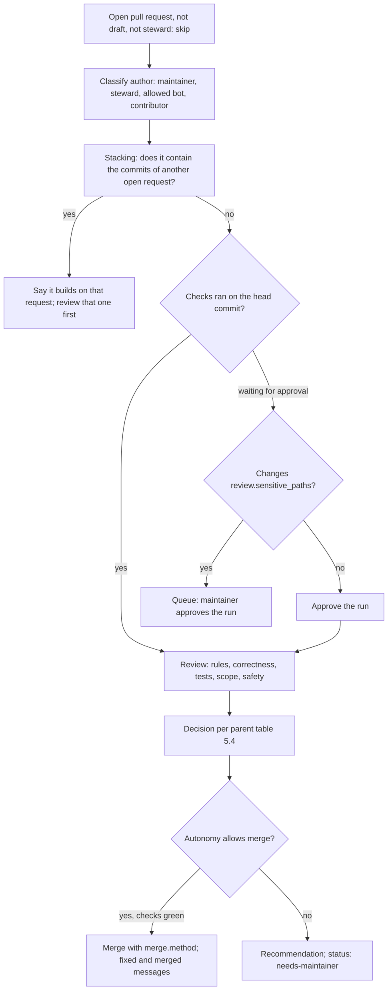

# Repo Steward Procedures (GitHub)

**Version:** 1.0.0
**Status:** Stable
**Layer:** implementation
**Implements:** l1-repository-stewardship.md

## Overview

How the `repo-steward` skill carries out the work that continues over time: the pull request procedure, the planning-ecosystem adapters, the Kanban board, the release-readiness computation and the workflow templates for unattended runs. The skill's files, profile, labels, messages and setup are in [l2-repo-steward-skill.md](l2-repo-steward-skill.md); this specification is split from it and keeps the same skill, scripts and templates. Nothing here names a particular project.

## Related Specifications

- [l1-repository-stewardship.md](l1-repository-stewardship.md) - Parent concept; "parent §" below refers to its sections.
- [l2-repo-steward-skill.md](l2-repo-steward-skill.md) - The skill's files, profile (§5.2), labels, run procedure, messages and markers (§5.6), run report and setup; the other half of this realization.
- [l2-repo-steward-godot-mcp.md](l2-repo-steward-godot-mcp.md) - The skill installed and configured for this repository, including the workflows it installs.

## 1. Motivation

The pull request flow, the board, the readiness rule and the unattended workflows are the parts of the skill that touch GitHub the most and change the most often. Keeping them in one specification lets the skill specification stay about structure and shared formats, and lets an agent that works on the board or a workflow open only what it needs.

## 2. Constraints & Assumptions

- The tools, authentication scopes and the portable-skill conventions of [l2-repo-steward-skill.md](l2-repo-steward-skill.md) §2 apply unchanged.
- GitHub facts the design relies on (checked 2026-10-20):
  - Workflow runs of a pull request from a fork by a first-time contributor wait for approval; a maintainer approves one with `POST /repos/{owner}/{repo}/actions/runs/{run_id}/approve`.
  - The workflow token (`GITHUB_TOKEN`) cannot read or write Projects; board updates from a workflow need a separate token with Projects access. Events caused by `GITHUB_TOKEN` start no further workflow runs.
  - Projects views are created with `POST /orgs/{org}/projectsV2/{number}/views` (or `/users/{user_id}/projectsV2/{number}/views`) with `name`, `layout` (`table`, `board`, `roadmap`), `filter`, `visible_fields`, `sort_by`, `group_by` and `vertical_group_by`. Column limits and the built-in project workflows are set only in the web interface.
  - The GraphQL mutation `updateProjectV2Field` takes `fieldId` and `singleSelectOptions`, a list of `{id, name, color, description}` (`color` and `description` required, `id` for an option that is kept) that replaces the field's whole option list; `createProjectV2StatusUpdate` posts a status update on a project; `createProjectV2View` and `updateProjectV2View` exist (schema introspected 2026-10-20).
  - `anthropics/claude-code-action` v1 starts only for actors with write access on issue, pull request and comment events, does not run for bots unless `allowed_bots` names them, and is not checked separately on `schedule` and `workflow_dispatch`.

## 4. Invariant Compliance

| L1 Invariant | Implementation |
| --- | --- |
| ST-7 Changes made the project's way | §5.2: the ecosystem adapter table decides how the plan and tasks are created; without an ecosystem, the plan message (kind `plan`) holds a task list kept current. `reference/changes.md` takes the branch rule, the verification commands, the commit and pull request conventions and the carrying rule from the guides. An ecosystem that is used (its artifacts are committed) but not installed in the environment (§5.2 "available") ends the pull step for the run with the reason in the report. |
| ST-9 Change requests decided on their merits | `reference/pull-requests.md`: §5.1 procedure and the decision table of the parent §5.4; reviews posted with `gh pr review` and one of `--approve`, `--request-changes`, `--comment`; edits pushed to the contributor's branch only when `maintainerCanModify` is true, otherwise a new pull request whose commits carry `Co-authored-by:` for the author; stacking and staleness detected as in §5.1. |
| ST-15 One flow board, explicit policies | `scripts/board.sh ensure` (§5.3): creates the project if no project with `board.title` exists for the owner, links it to the repository, creates the fields and views, writes the policies README, and prints the ids the run needs. Each run adds missing items, sets Status from the item's real state, sets `Started` when Status becomes In Progress and `Finished` when it becomes Done, and writes the block reason to `Blocked`. |
| ST-17 Readiness notice, never a release | `scripts/readiness.sh` (§5.4) computes the state and the notice text; with `--publish` it creates, updates or closes the one open issue labelled `release-readiness`. The skill contains no `git tag`, `git push --tags` or `gh release` command. |

The other invariants (ST-1 to ST-6, ST-8, ST-10 to ST-14, ST-16, ST-18) are realized in [l2-repo-steward-skill.md](l2-repo-steward-skill.md) §4.

## 5. Detailed Design

### 5.1 Pull Requests



- **Stacking:** request B builds on A when every non-merge commit of A is in B (commits with one parent, from GraphQL `commits { commit { oid parents { totalCount } } }`: a contributor who merges the base branch into each branch creates merge commits that never match) or B's base branch is A's head branch. Requests that share leading commits without containing each other build on a common unmerged base; the author is asked which request is the base.
- **Staleness:** `mergeStateStatus` `BEHIND` → `gh pr update-branch {n}` when the author allows edits; `DIRTY` (conflicts) → resolved by the steward as an edit when the author allows edits and the resolution is mechanical, otherwise the author is asked to rebase.
- **Run approval:** `gh run list --event pull_request --status action_required --json databaseId,headSha` matched by head SHA, then `gh api -X POST repos/{owner}/{repo}/actions/runs/{id}/approve`.
- **Checks green:** the branch protection's required checks when the base branch has any, otherwise every check run on the head commit; none failing or pending, and at least one finished.
- **Review checklist** (`reference/pull-requests.md`): target branch per the guides' routing rules; a test for new behaviour; commit and description conventions; one logical change; files the guides forbid touching (versions, changelog sections, secrets, machine-specific files); new dependencies (purpose, license, maintenance); code that reads credentials, opens network connections, spawns processes or is obfuscated; changes to `.github/` and build scripts; documentation for changed behaviour; and, in a project with a planning ecosystem, whether planned behaviour changes, which the steward then routes through the ecosystem.
- **Edits:** with `maintainerCanModify`, `gh pr checkout {n}`, edit, commit in the project's convention, push; CI verifies. Without it, a new pull request from a steward branch carrying the author's commits plus the edits, `Co-authored-by: {name} <{email}>` in the edit commits, and the original closed with a link.

### 5.2 Planning Ecosystems

| Adapter | Used when | Available when | Planning paths | Plan and tasks |
| --- | --- | --- | --- | --- |
| Guide-declared | a guide names its planning commands or plan location | the named command or path exists | the named location | the guide's commands; this row wins over the others |
| `magic-spec` | `.design/` exists | `.magic/` exists too | `.design/` | `/magic.spec` with the item's requirement and link as raw input (it hands over to `/magic.task`), then `/magic.run`; planning files committed separately from product changes |
| `spec-kit` | `.specify/` exists | the agent has the `/speckit.*` commands | `.specify/`, `specs/` | `/speckit.specify` → `/speckit.plan` → `/speckit.tasks` → `/speckit.implement` |
| `kiro` | `.kiro/specs/` exists | always (files only) | `.kiro/` | the feature's `requirements.md`, `design.md` and `tasks.md`, written as Kiro lays them out |
| `openspec` | `openspec/` exists | the `openspec` command exists | `openspec/` | a change proposal under `openspec/changes/` <!-- TBD: confirm the OpenSpec command names at implementation. --> |
| `exec-plans` | a plans directory a guide names (for example `docs/exec-plans/`) | always (files only) | that directory | a plan file there, in the guide's format |
| `none` | nothing above | — | — | the plan message on the item |

The profile names an adapter only to override detection; leaving `planning.ecosystem` at `auto` keeps the profile valid when the ecosystem is removed from the repository.

A pull request from the steward never mentions planning artifacts in its title or in product files; it may name them in its description, which is git metadata.

### 5.3 Board

`scripts/board.sh ensure` is idempotent:

```plaintext
[REFERENCE]
gh project list --owner {owner} --format json --limit 100             -> find board.title
gh project create --owner {owner} --title "{board.title}" --format json
gh project link {number} --owner {owner} --repo {owner}/{repo}
gh project edit {number} --owner {owner} --visibility PUBLIC|PRIVATE --readme "$(policies)" --description "..."
gh project field-create {number} --owner {owner} --name Priority --data-type SINGLE_SELECT --single-select-options "P0,P1,P2,P3"
gh project field-create ... Kind (Bug, Feature, Docs, Question, Chore) · Started, Finished (DATE) · Blocked (TEXT) · board.text_fields (TEXT)
Status options -> Triage, Backlog, Ready, In Progress, In Review, Done via updateProjectV2Field
                  (the new project's Todo becomes Backlog, In Progress and Done keep their ids)
views: POST /orgs/{owner}/projectsV2/{number}/views (or /users/{user_id}/...)
  Flow                board,  vertical_group_by [Status], sort_by [[Priority, asc]]
  Triage queue        table,  filter "status:Triage"
  Awaiting maintainer table,  filter "label:\"status: needs-maintainer\""
  Finished            table,  filter "status:Done", sort_by [[Finished, desc]]
items: board.sh item <url> Field=Value ... [--archive]   (item-add, then item-edit by field name)
status update: board.sh status-update <text>          (createProjectV2StatusUpdate)
```

Every board write goes through `board.sh`, which finds the ids. With `STEWARD_BOARD_QUEUE` set (the unattended workflow) `item` and `status-update` validate their arguments without network access — this repository's items only, the known fields and options, one-line values of at most 200 characters, dates as `YYYY-MM-DD` — and append them to the queue; `board.sh apply`, run by a step that holds `STEWARD_PROJECT_TOKEN`, validates each line again and carries it out. The agent never holds a token that reaches Projects.

A view is created only when no view with its name exists. The README is `templates/board-readme.md` with the profile's values: the column policies, WIP limits, classes of service and the rubric of the parent §5.2 and §5.7.

Status from the item's real state, on every run:

| Real state | Status |
| --- | --- |
| open, untriaged, or reopened | Triage |
| triaged, not yet reproducible or specified, or waiting for information | Backlog |
| reproduced or specified, unblocked, not started | Ready |
| a steward or person branch exists for it, no pull request | In Progress |
| an open pull request resolves it, or it is itself an open pull request | In Review |
| closed as completed, or merged | Done |
| closed as not planned or duplicate | archived on the board (the issue stays) |

### 5.4 Readiness

```plaintext
[REFERENCE] scripts/readiness.sh [--default-branch <name>] [--publish]   (STEWARD_OFFLINE=1: no network call)
last   = highest tag matching release.tag_pattern (semver order); none -> "no release yet"
range  = last..origin/{default branch}, first parent
counted commits = range minus subjects starting with release.skip_subjects
                  minus commits that touch only release.ignore_paths
kind   = Conventional Commit type: "!" or "BREAKING CHANGE" -> breaking; feat; fix; perf; else internal
user-facing = breaking + feat + fix + perf
p0, p1 = fixes whose pull request closes an issue labelled priority: P0 / P1
          (gh pr list --state merged --search "merged:>{last date}" --json closingIssuesReferences,mergeCommit)
state  = now        if any p0
         due        if a p1 fix merged >= release.p1_days ago, or user-facing >= release.changes_threshold,
                    or the oldest user-facing commit >= release.age_days old
         accumulating if user-facing > 0
         none       otherwise
next   = last bumped: breaking -> major (minor before 1.0), feat -> minor, else patch
targets (when release.targets_file is set): for each target t
         branch = release.target_branch with {t}; build = file release.target_build_file on origin/{branch}
         own    = commits in {release.target_tag with last, t}..origin/{branch} minus release bookkeeping
output: line 1 "state={state} version={next}"; then the notice in Markdown
--publish: state none -> close the open notice with a comment if there is one
           else create or edit the one open issue labelled release-readiness;
           add a comment only when the state rose (accumulating -> due -> now) since the last marker;
           close it with a comment when a tag >= {next} exists
```

Notice layout: title `Release readiness: v{next} ({state})`; sections Recommendation (state, number and why), User-facing changes (one line per commit, with its pull request and closed issues), Release targets (target, branch, build, own changes), How to release (the profile's `release.procedure` and its first step), Not counted (number of internal commits).

### 5.5 Workflow Templates

| Template | Triggers | Permissions | Does |
| --- | --- | --- | --- |
| `steward-stale.yml` | daily schedule, manual | `actions: write` (the action keeps its state in the cache), `issues: write`, `pull-requests: write` | `actions/stale` on `status: needs-info` only: reminder after `timing.needs_info_reminder_days` with label `status: stale`, close as not planned after `timing.needs_info_close_days` more; pull requests get the reminder and are never closed; messages carry the disclosure line and markers `kind=reminder` / `kind=not-planned` |
| `steward-readiness.yml` | push to the default branch, weekly schedule, `release: published`, manual | `contents: read`, `issues: write` | full-history checkout, `readiness.sh --publish` with `GH_TOKEN` = the workflow token |
| `steward-agent.yml` | daily schedule, manual (inputs `scope`, `mode`) | `contents: read`, `issues: write`, `pull-requests: write`, `actions: read` | only when the repository variable `STEWARD_AGENT` is `on`: default-branch checkout with `persist-credentials: false`; `anthropics/claude-code-action` pinned to a commit SHA, with the secret `ANTHROPIC_API_KEY` (or `CLAUDE_CODE_OAUTH_TOKEN`), `github_token` = the workflow token, a prompt that runs this skill with `--unattended`, a step before it that makes `.agents` read-only, `CLAUDE_CODE_SUBPROCESS_ENV_SCRUB` kept on, `claude_args` allowing reading files, the read-only `gh issue`/`gh pr`/`gh search`/`gh label list`/`gh run` commands and each of the skill's scripts by exact name (no `git`: `git log` and `git show` write files with `--output`), and denying reads under `/proc`, `/sys`, the runner's temporary and configuration directories and `.git`; `STEWARD_BOARD_QUEUE` names the queue file. A following step, the only one with `STEWARD_PROJECT_TOKEN`, runs `board.sh apply` on the queue |

Every template sets `concurrency: {group: repo-steward-<name>, cancel-in-progress: false}`, pins GitHub's own actions by major version and every other action by full commit SHA with the version in a comment, and uses no `pull_request_target` event and no checkout of a pull request's head. The agent run has no `contents: write`, so it cannot push or merge; with `--unattended` it queues every action whose class is at `approval` instead of asking. The installed copies are produced by the setup procedure from the templates and the profile; rerunning setup shows the difference between an installed copy and what the template would produce now.

## 7. Drawbacks & Alternatives

- **Event-triggered agent runs (`issues: opened`, `pull_request_target`):** first answers within minutes, but an outsider's event would start an agent holding a write token; `claude-code-action` also refuses non-writers by default, and opening that up (`allowed_non_write_users: "*"`) is what its own security guide warns against. Rejected for the unattended run; a scheduled run reaches every new item within a day.
- **Reusable workflows called from a central repository:** one copy for every installation, but each repository then depends on another repository's default branch for its automation; templates copied at setup keep each repository self-contained.

## Canonical References

| Alias | Path | Purpose |
| --- | --- | --- |
| `[PR-REF]` | `.agents/skills/repo-steward/reference/pull-requests.md` | Review checklist and decisions |
| `[CHANGES-REF]` | `.agents/skills/repo-steward/reference/changes.md` | Pull, plan, fix, review and merge steps |
| `[BOARD-REF]` | `.agents/skills/repo-steward/reference/board.md` | Fields, views and policies text |
| `[READINESS-REF]` | `.agents/skills/repo-steward/reference/readiness.md` | Readiness rule and notice layout |
| `[BOARD]` | `.agents/skills/repo-steward/scripts/board.sh` | Board creation, items, queue and apply |
| `[READINESS]` | `.agents/skills/repo-steward/scripts/readiness.sh` | Readiness state and notice |
| `[API]` | `.agents/skills/repo-steward/scripts/api.sh` | The fixed reads |
| `[WORKFLOWS]` | `.agents/skills/repo-steward/templates/workflows/` | Workflow templates for unattended runs |

## Document History

| Version | Date | Author | Description |
| --- | --- | --- | --- |
| 1.0.0 | 2026-10-21 | Agent (magic.spec) | Split from l2-repo-steward-skill.md 1.0.5 when that specification passed the 300-line bloat limit: the pull request procedure, planning adapters, board, readiness and workflow templates (its former §5.7 to §5.11) with the invariant rows ST-7, ST-9, ST-15 and ST-17 and the GitHub facts they rest on. No requirement changed. |
